# TryHackMe - Cache Me Outside


**Room:** [Cache Me Outside](https://tryhackme.com/room/cachemeoutside?utm_campaign=social_share&utm_medium=social&utm_content=share-completed-room&utm_source=copy&sharerId=687ee2d55d26d5dd224d2726)

**Difficulty:** Medium

**Description:** Can you find this ex hacker turned outdoorsman?

## Challenge

- Years after walking away from the scene, a retired hacker has left pieces of his identity scattered across the open internet.

- You are an OSINT investigator tasked with identifying the retired hacker and tracing the clues he left behind.

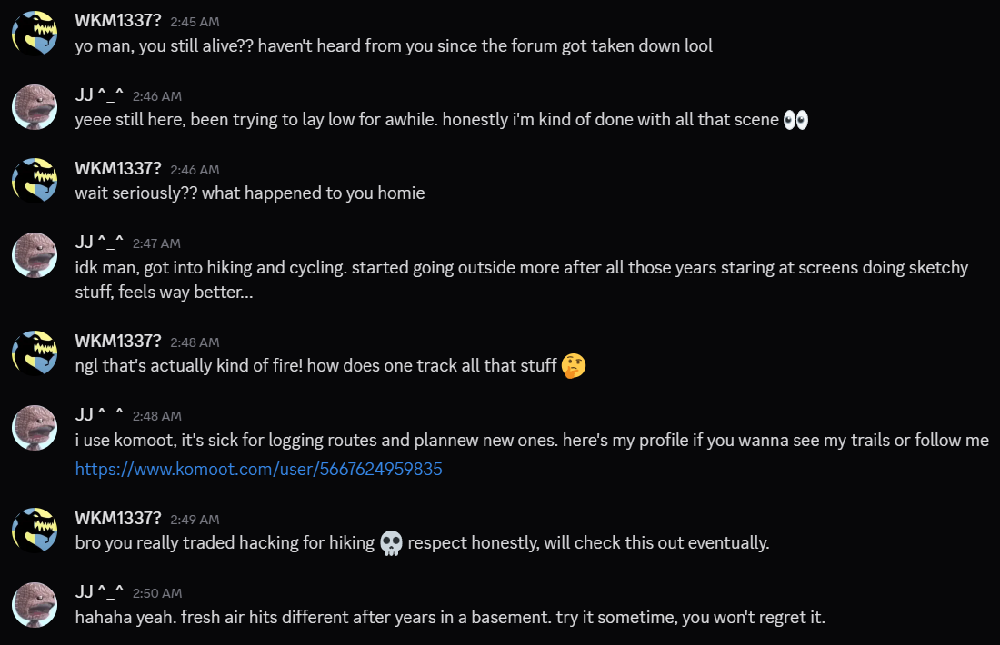

## Steps

### Step 1


go to

```
https://www.komoot.com/user/5667624959835
```

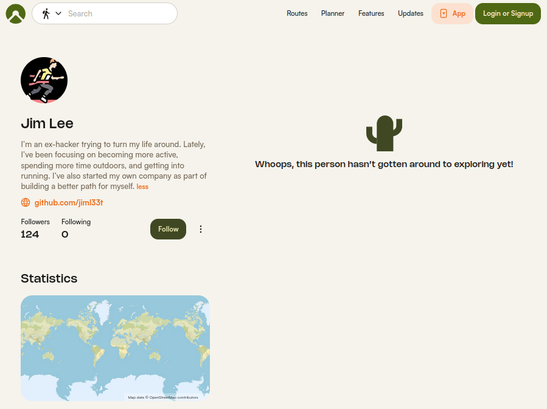

This reveals the hacker's Komoot profile, where his name `Jim Lee` and github `https://github.com/jiml33t` are revealed.

---
### Step 2

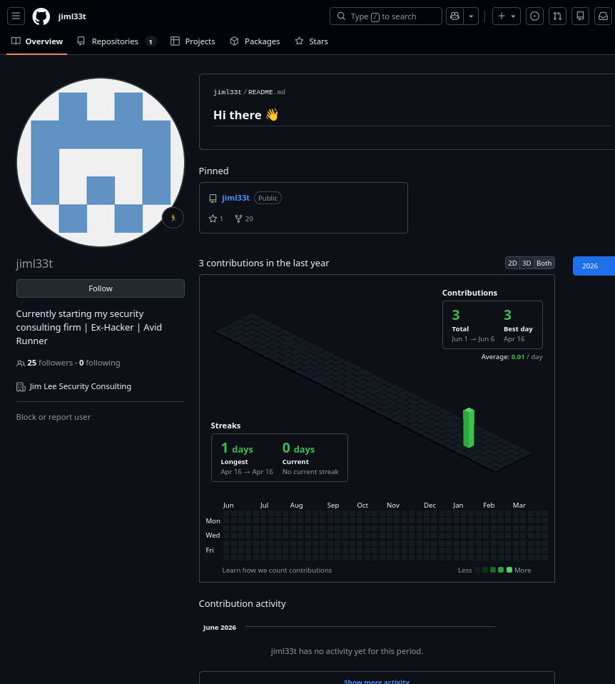

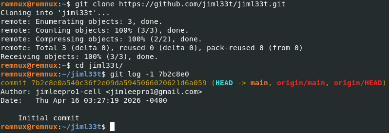

Clone the attached repository from the hacker's github profile with:

```bash
git clone https://github.com/jiml33t/jiml33t.git
```

then `git log` the latest commit

```bash
git log -1 7b2c8e0
```

to reveal his email `jimleepro1@gmail.com`

---
### Step 3

Email the hacker asking for phone number, and an automated response should respond:

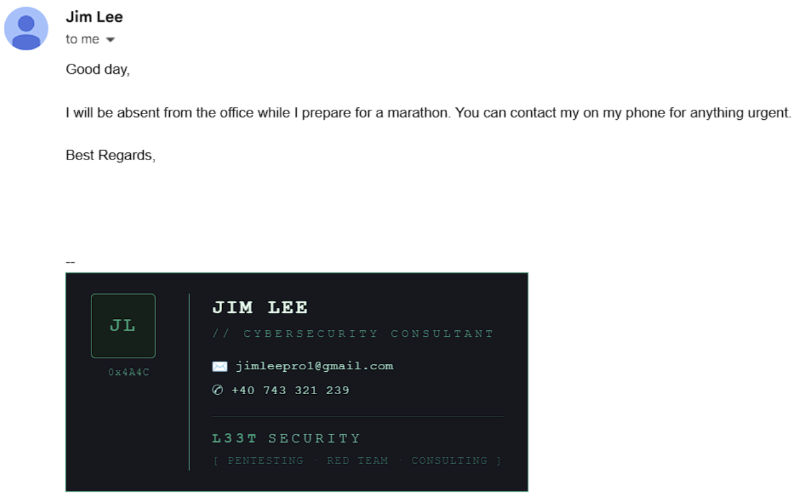

phone number `+40 743 321 239` aquired.

---
### Step 4

Using `https://www.idcrawl.com/u/jiml33t` we can use his username `jiml33t` to find his threads account

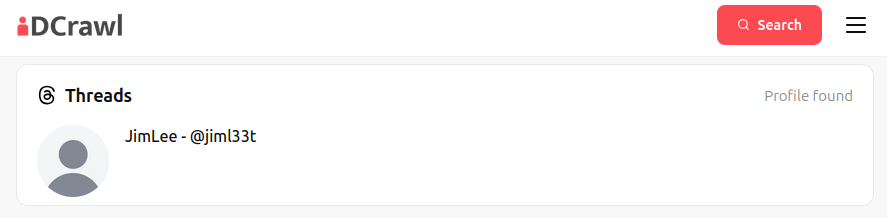

more information is revealed on the threads page `https://www.threads.com/@jiml33t`

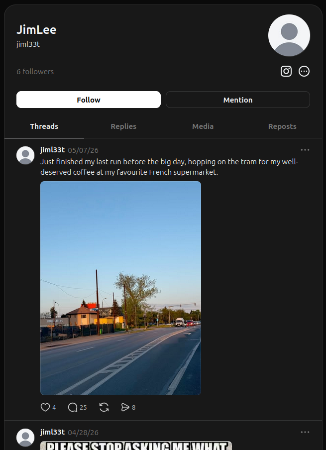

The image contains the company `irigatti.ro` through which you can find the location of the photo.

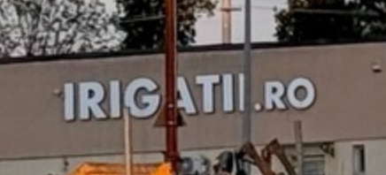

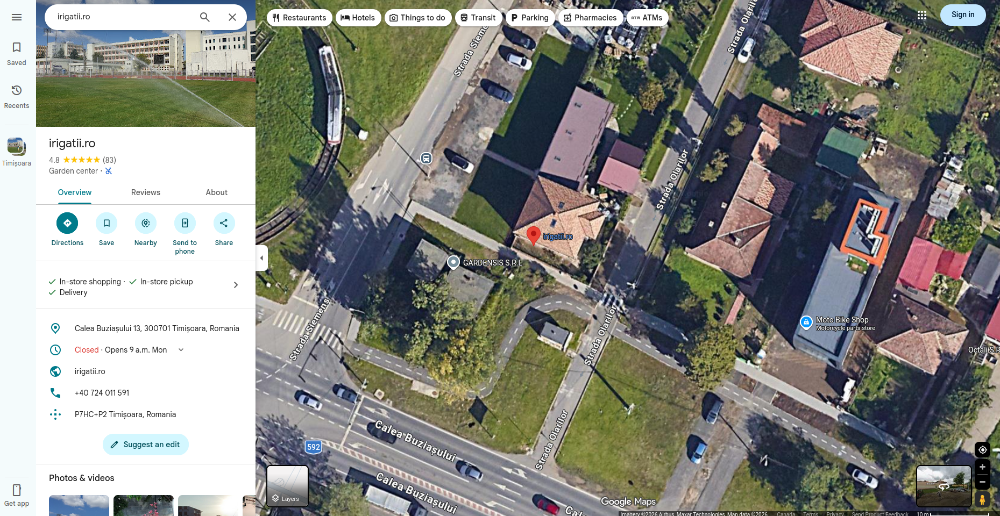

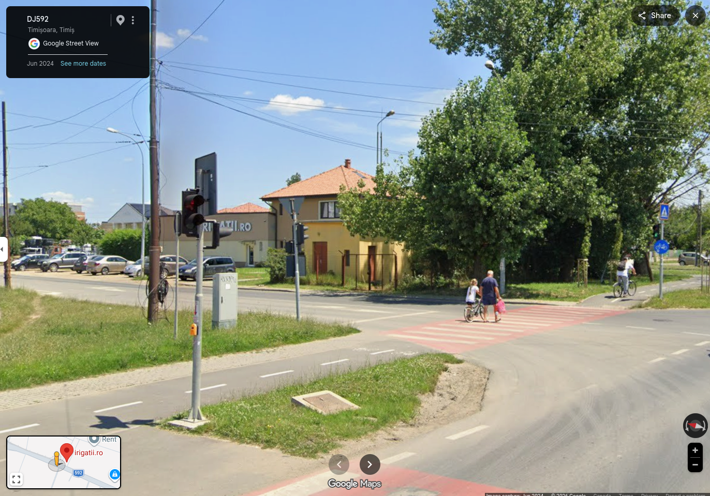

Or you can run it through AI to geolocate the place

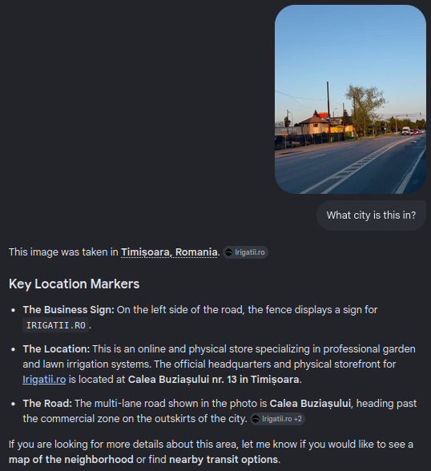

Either way allows us to find that `Timișoara` is the location

---
### Step 5

to find the tram station, you can explore the nearby tram station through google maps until you discover `Piața Gheorghe Domășneanu` tram station.

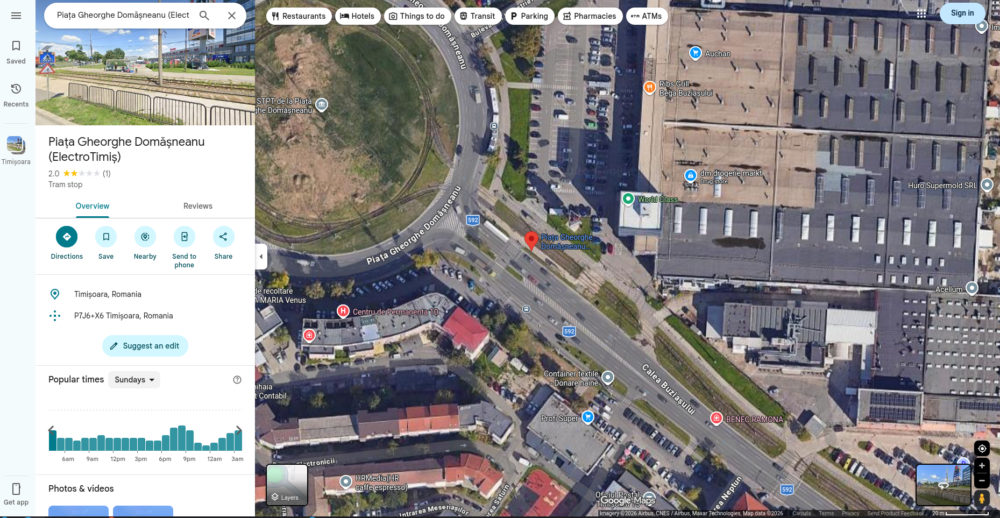

---
## Answers

### Question 1

What is the retired hacker’s full name?

- Answer: `Jim Lee`

### Question 2

What email address did he accidentally expose?

- answer: `jimleepro1@gmail.com`

### Question 3

What is his phone number?

- answer: `+40 743 321 239`

### Question 4

In which city is he located?

- answer: `Timișoara`

### Question 5

Submit the name of the tram station where he got off on the 7th of May, 2026.

- answer: `Piața Gheorghe Domășneanu`

---