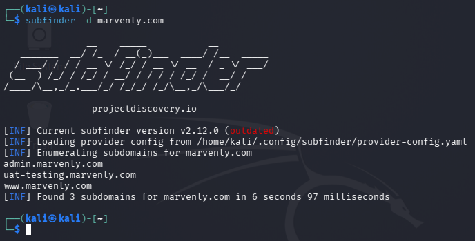
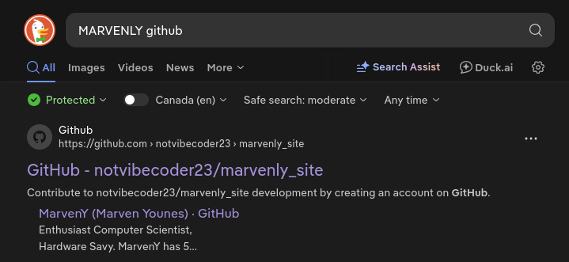
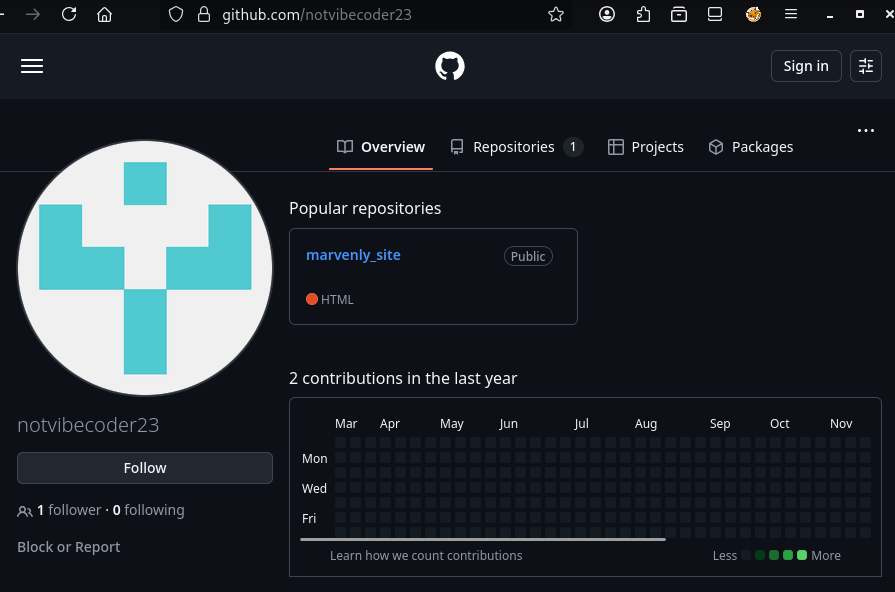
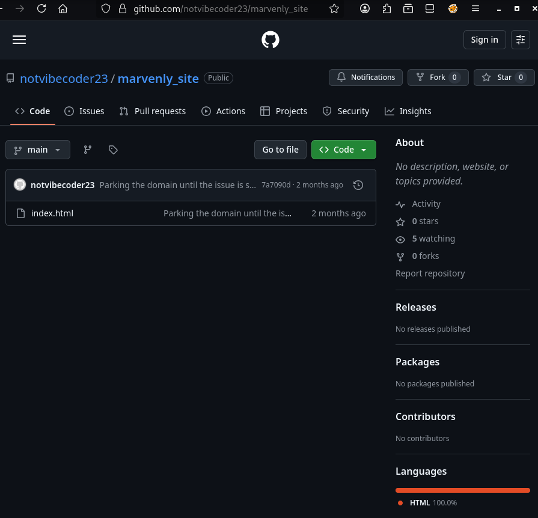
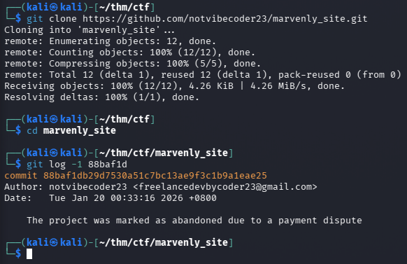
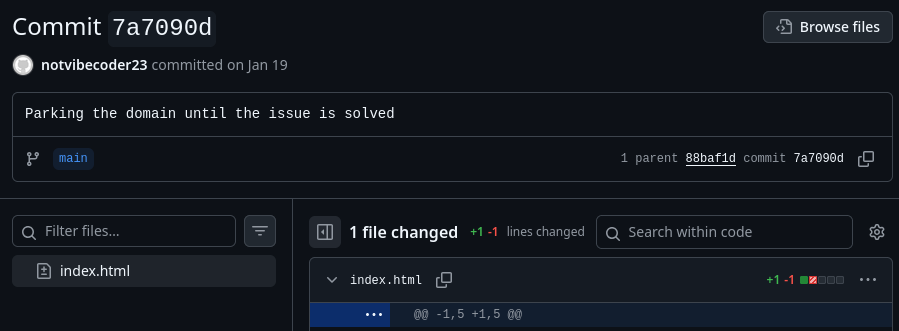
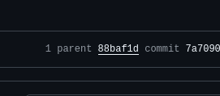
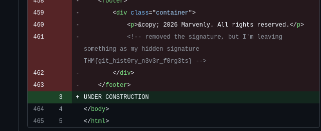

# TryHackMe - Dev Diaries


**Room:** [Dev Diaries](https://tryhackme.com/room/devdiaries?utm_campaign=social_share&utm_medium=social&utm_content=share-completed-room&utm_source=copy&sharerId=687ee2d55d26d5dd224d2726)

**Difficulty:** Easy

**Description:** Hunt through online development traces to uncover what was left behind.

## Challenge

We have just launched a website developed by a freelance developer. The source code was not shared with us, and the developer has since disappeared without handing it over.

Despite this, traces of the development process and earlier versions of the website may still exist online.

You are only given the website's primary domain as a starting point: marvenly.com

## Steps

### Step 1



First, run `subfinder` on the target domain. the command used here was:

```bash
subfinder -d marvenly.com
```

This reveals two additional subdomains:
- `admin.marvenly.com`
- `uat-testing.marvenly.com`

The development version of the website is hosted on `uat-testing.marvenly.com`.

---
### Step 2


Visiting the subdomain reveals the branding "MARVENLY", which can be used to identify the developer online.

---
### Step 3



Searching for `MARVENLY github` helps identify whether the developer has a public repository or account tied to the project.

---
### Step 4



The username is `notvibecoder23`

---
### Step 5





Clone the repository and navigate into it:

```bash
git clone https://github.com/notvibecoder23/marvenly_site.git
cd marvenly_site
```

Inspect a specific commit using:

```bash
git log -1 88baf1d
```

This reveals the developer’s email, `freelancedevbycoder23@gmail.com`, along with the commit message stating that `The project was marked as abandoned due to a payment dispute`.

---
### Step 6



Navigate to the repository’s commit history to review previous changes.



Select the previous commit to view the repository before the changes were made.



Scrolling to the bottom of the code reveals the hidden flag: `THM{g1t_h1st0ry_n3v3r_f0rg3ts}`.

---
## Answers

### Question 1

What is the subdomain where the development version of the website is hosted?

- answer: `uat-testing.marvenly.com`

### Question 2

What is the GitHub username of the developer?

- answer: `notvibecoder23`

### Question 3

What is the developer's email address?

- answer: `freelancedevbycoder23@gmail.com`

### Question 4

What reason did the developer mention in the commit history for removing the source code?

- answer: `The project was marked as abandoned due to a payment dispute`

### Question 5

What is the value of the hidden flag?

- answer: `THM{g1t_h1st0ry_n3v3r_f0rg3ts}`

---